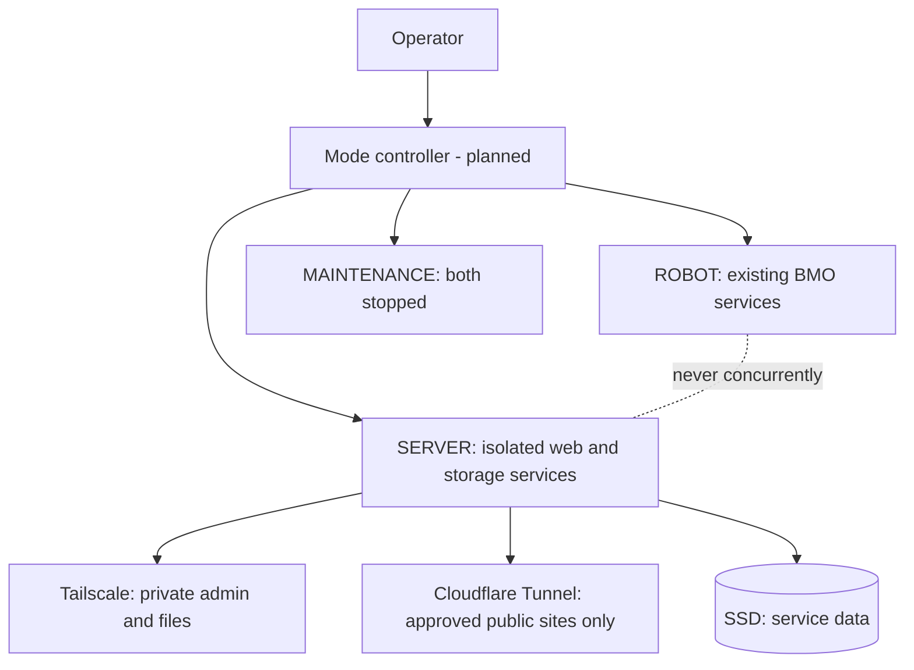

# BMO NEXUS

### One Raspberry Pi. Two operating modes. A personal cloud and web lab built into BMO.

[English](README_EN.md) | **한국어** | [원본 BMO 로봇 프로젝트](https://github.com/GUNOBAE/BGH_BMO)

> **Project status: DESIGN / PRE-DEPLOYMENT.** This repository is the server-mode and lifecycle-control plan for a custom BMO robot. It is **not** a running, publicly accessible server. Existing robot software and its approved screen design are kept independent.

## 프로젝트 소개

**BMO NEXUS**는 자체 제작 BMO 로봇에 장착된 **Raspberry Pi 5 (8 GB)**와 저장장치를 재활용해, 로봇을 시연하지 않을 때 개인 클라우드·GitHub 백업·웹 실험실을 제공하는 프로젝트다.

로봇과 서버를 무리하게 동시에 돌리는 대신, **한 운영체제에서 역할을 전환**한다. 전환 시스템은 기존 BMO 앱을 재작성하지 않고 시작/종료만 관리하도록 설계한다.

| 구분 | ROBOT MODE | SERVER MODE | MAINTENANCE |
|---|---|---|---|
| BMO 얼굴·대화·하드웨어 | 실행 | 정지 | 정지 |
| 개인 클라우드·백업·웹 실험 | 정지 | 실행 | 정지 |
| 공개 웹 연결 | 차단 | 승인된 사이트만 | 차단 |
| 관리자 사설망(Tailscale) | 유지 가능 | 유지 | 유지 |

> **주의:** 애플리케이션 모드 분리는 CPU/RAM과 주변장치 충돌을 줄이는 구조다. 같은 OS를 사용하므로 **완벽한 보안 격리**는 아니다. 공개된 웹앱이 침해되면 같은 호스트의 다른 데이터도 위험할 수 있다.

## Hardware

| 구성 | 정보 |
|---|---|
| Computer | Raspberry Pi 5 · 8 GB RAM |
| NVMe SSD | 1 TB (present, but device currently reports **0B**; unmounted; do not format) |
| microSD | 512 GB (**confirmed OS/root filesystem**: `/dev/mmcblk0p2`) |
| Robot hardware | Existing 7-inch BMO display, audio, camera, RP2040 control chain |

저장장치의 실제 부팅/마운트 경로를 확인하기 **전에는 포맷이나 OS 이전을 진행하지 않는다.**

## 계획된 기능

- **Mode Controller** — ROBOT / SERVER / MAINTENANCE 전환, 상태 검증, 실패 시 비공개 유지
- **Nexus Vault** — 개인 파일 웹 관리(SFTPGo 검토), 사설망에서만 접속
- **Nexus Mirror** — GitHub 저장소 미러 + 버전별 암호화 백업(restic 검토)
- **Nexus Lab** — 다양한 테스트용 웹앱. 외부에는 명시적으로 허가한 사이트만 공개
- **Nexus Monitor** — 온도·RAM·디스크·서비스·백업 상태 확인
- **Network Boundary** — 관리망(Tailscale)과 공개망(Cloudflare Tunnel) 분리

**포트폴리오 웹사이트, 웹 UI 디자인 및 프런트엔드 개발은 별도 개발 세션의 범위다.** 이 저장소는 인프라·운영 방식·기본 스크립트에 집중한다.

## Architecture



처음에는 복잡한 플랫폼보다 **읽기 전용 점검 → 원본 백업 → 사설망 파일 서비스 → 안전한 모드 전환 → 제한적 웹 공개** 순서로 진행한다.

## 개발 현황

| 항목 | 상태 |
|---|---|
| 요구사항·운영 원칙 | ✅ 문서화 |
| Pi 부팅 디스크·OS·실행 서비스 실측 | ✅ 1차 조사 완료; SSD와 BMO 런처 추가 확인 필요 |
| BMO 원본 백업 및 복원 테스트 | ⬜ 미검증 |
| 서버 프로그램 배포 | ⬜ 미실시 |
| 모드 전환 구현·현장 시험 | ⬜ 미실시 |
| 인터넷 공개 및 외부 보안 점검 | ⬜ 미실시 |

## 문서

- **[처음 시작하는 방법 — GitHub 업로드와 첫 명령](START_HERE_KR.md)**
- [처음 시작하는 구현 순서와 확인 기준](docs/01_IMPLEMENTATION_PLAN_KR.md)
- [BMO 원리부터 배우는 용어/실습 안내](docs/02_LEARNING_GUIDE_KR.md)
- [ROBOT/SERVER/MAINTENANCE 모드 설계](docs/03_MODE_CONTROLLER_KR.md)
- [네트워크 분리 및 보안](docs/04_SECURITY_KR.md)
- [저장장치·GitHub 백업·복원](docs/05_STORAGE_BACKUP_KR.md)
- [기존 BMO와 안전하게 연결하기](docs/06_BMO_INTEGRATION_KR.md)
- [현재 사실 및 확인해야 할 항목](docs/07_STATUS_AND_ASSUMPTIONS_KR.md)
- [2026-10-25 Raspberry Pi 현장 진단 요약](docs/09_PI_BASELINE_KR.md)
- [Codex 협업 규칙과 구현 작업 방식](docs/10_CODEX_WORKFLOW_KR.md)
- [Codex 영구 작업 규칙](AGENTS.md)
- [Codex 첫 작업 — SSD/BMO 안전 점검 (Issue #1)](https://github.com/GUNOBAE/BGH_BMO_NEXUS/issues/1)
- [다른 채팅의 웹 개발 인계서](docs/08_WEB_CHAT_HANDOFF_KR.md)
- [공식 참고 문서](docs/REFERENCES.md)

## 첫 번째 실제 작업 — 읽기만 하는 점검

Pi의 기존 BMO 환경을 변경하지 않는 점검 도구를 제공한다.

```bash
bash scripts/inspect_pi.sh
```

출력에는 실행 중인 서비스 이름이나 내부 경로 등이 포함될 수 있다. **원문을 공개 이슈/README에 복사하지 말 것.** 점검 결과로 OS/아키텍처/부팅 디스크/자동 시작 서비스/포트 점유를 확인한 뒤 서버 설치 방식을 결정한다.

## Scope and credits

- BMO 로봇의 CAD/PCB/얼굴/음성은 원본 저장소에서 계속 관리한다.
- 이 저장소에는 로봇 원본 자산, API 비밀키, 개인 파일, 백업 아카이브를 저장하지 않는다.
- 기초 로봇 프로젝트: [GUNOBAE/BGH_BMO](https://github.com/GUNOBAE/BGH_BMO)
- 현재 **설계 및 준비 단계**이며 기능 구현 완료를 주장하지 않는다.
