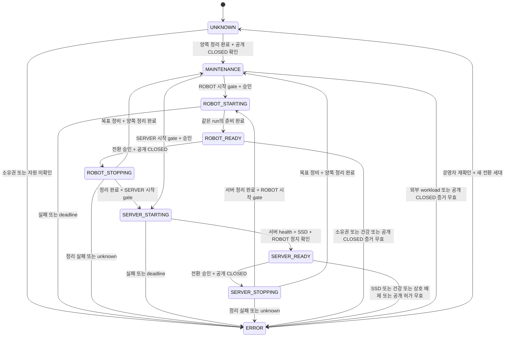

# Phase 2B — BMO 실행·종료와 NEXUS 모드 전환 계약

> [Issue #4](https://github.com/GUNOBAE/BGH_BMO_NEXUS/issues/4)의 **문서 설계**다.
> BMO 사실 인계와 설계 리뷰를 반영했다. 아래 새 인터페이스·상태기계·정리 완료 조건은
> **미구현·Pi 미적용**이다. BMO의 실제 종료/재시작, 서비스/권한/SSD 변경, 유료 API 호출을 하지 않았다.

## 1. 범위·근거·상태 표시

NEXUS는 기존 BMO를 재작성하거나 임의로 종료하는 계층이 아니다. 이 문서는 어떤 증거가
있어야 ROBOT/SERVER 전환을 허용할 수 있는지 정한다. 현재 그 증거가 부족하므로
**실제 Mode Controller의 호스트 적용과 자동 전환은 차단 상태**다.

근거를 읽은 순서와 적용 범위는 다음과 같다.

1. [Issue #4 원문](https://github.com/GUNOBAE/BGH_BMO_NEXUS/issues/4),
   [후속 인계 순서](https://github.com/GUNOBAE/BGH_BMO_NEXUS/issues/4#issuecomment-6400304649).
2. [BMO 담당 상세 사실 인계](https://github.com/GUNOBAE/BGH_BMO_NEXUS/issues/4#issuecomment-6400459832):
   관측 기간은 2026-10-26 01:43~01:52 KST다. 이 문서 작성 시 새 현장 조사를 반복하지 않았다.
3. [NEXUS 설계 리뷰](https://github.com/GUNOBAE/BGH_BMO_NEXUS/issues/4#issuecomment-6400500959):
   실행/종료 경로는 수용하지만, 정리 완료·시간 상한·실물 해제를 증명하지 못했다고 판정했다.
4. [모드 설계](03_MODE_CONTROLLER_KR.md), [BMO 통합 경계](06_BMO_INTEGRATION_KR.md),
   [보안](04_SECURITY_KR.md), [기존 현장 기록](09_PI_BASELINE_KR.md),
   [NVMe 조사 경계](12_NVME_TRIAGE_KR.md).

| 표시 | 이 문서에서 뜻하는 것 |
|---|---|
| **확인됨·인계 관측** | BMO 담당이 해당 시점에 읽기 전용으로 확인했고 리뷰가 수용한 사실. 현재까지 계속 같은 상태라는 보장은 아님 |
| **구현만 확인** | 고정한 BMO 커밋에 코드 경로가 있음. 실물 성공·최대 시간·현재 준비 상태를 증명하지 않음 |
| **실 Pi 미검증 / NOT_RUN** | 해당 장치/종료/재진입 시험을 하지 않음. 관측이나 Mock PASS로 대체하지 않음 |
| **미확인** | 값·원인·소유권·판정 근거가 없거나 부족함. 임의 기본값으로 채우지 않음 |
| **개발 중·Pi 미적용** | NEXUS 제어기와 제안된 새 계약. 실행 가능한 CLI/API/서비스가 있다는 뜻이 아님 |

이전 문서의 2026-10-25 기록은 역사적 기준으로 보존한다. 예를 들어 그날의 Node 관측을
현재 BMO의 소유 자식이라고 확대하지 않는다. 새 인계는 지정된 checkout/커밋 범위에만 적용한다.

## 2. BMO의 현재 실행 범위

| 대상 | 고정된 사실 | 적용 판정 |
|---|---|---|
| 보존 `BMO_FEATURES` | `feature/bmo-desktop-app-v1`, `b4be622ec831721635332f7ce3ad39c6d16c7870`; 기존 venv 존재, Git clean | 확인됨·인계 관측. 이전 실행 경로 보존 |
| 최신 `BMO_NIGHTLY` | `feature/bmo-camera-video-and-qa-v1`, `0287bb23c1fafc357c9a18419f62b2ebdf0de767`; Git clean | **실제 수동 개발 실행도 관측됨**. 최신 코드 전체를 Pi 미적용으로 분류하면 안 됨 |
| 최신 interpreter | 자체 `.venv/bin/python`은 없었음. 실제 실행 때 선택한 interpreter/환경은 수집하지 않음 | 미확인. NEXUS 시작의 필수 차단 항목 |
| 관측된 앱 | GUI 사용자 UID1000, `-m bmo_ai.desktop_app --live --windowed --ptt-microphone`, 소유 Chromium 자식 및 공유 lock 점유 | 확인됨·인계 관측. 정식 desktop 설치·PTT 성공·하드웨어 합격은 아님 |
| 자동 실행 | 조사한 system/user unit·desktop entry·GUI/labwc·cron·로그인 경로에서 BMO 앱 시작 설정을 찾지 못함 | 확인한 범위에서 미발견. 다른 사용자/간접 script/재부팅 전체 동작은 미확인 |
| runtime 디렉터리 | 관측 중 소유자 전용 요구와 다른 0770에서 0700으로 변함 | 시점별 관측. 변경 주체·재로그인 후 재발 여부 미확인. 자동 chmod 근거가 아님 |
| 앱/PID 소멸 | 관측된 부모·Chromium이 이후 스냅샷에서 사라지고 lock이 미점유였음 | 원인·exit code·전체 orphan/장치 해제 미확인. 정상 종료 PASS가 아님 |
| NEXUS 제어·배포 | fixed ready/clean-exit 계약, Mode Controller, 호스트 적용 | 개발 중·Pi 미적용 |

현재 앱 상태를 이 표에서 추론해 신호를 보내거나 실행하지 않는다. 개인 경로·PID·전체 argv·
실제 환경·토큰은 계약 문서에 복사하지 않는다.

### 주 진입점과 사전 조건

[`launch-desktop`](https://github.com/GUNOBAE/BGH_BMO/blob/0287bb23c1fafc357c9a18419f62b2ebdf0de767/launch-desktop#L1)은
자신의 checkout 기준 `software`로 이동한 뒤, `BMO_PYTHON` 또는 기본 프로젝트 venv의
Python을 선택해 `-B -m bmo_ai.desktop_app`를 `exec`한다. wrapper PID를 Python이 이어받는다.

확인한 코드의 수동 옵션은 `--live --windowed`이고 최신판에만 `--ptt-microphone`이 있다.
여기서는 복사해 실행할 완성 명령을 제공하지 않는다. 실제 interpreter 경로·버전·환경이
확정되지 않았고, live 시작은 캐시 인사를 실제 스피커로 재생할 수 있는 동작이기 때문이다.

- GUI 사용자, Wayland 세션 정보, 해당 사용자가 소유한 runtime **정확한 0700**, 안전한
  Chromium, 승인 얼굴 SHA가 필요하다. headless/root service에서의 시작은 미검증이다.
- `BMO_PYTHON`은 interpreter 선택 변수이며 API 키 전달 수단이 아니다. 키는 기존 private
  store에서 처리한다. NEXUS가 키를 argv·로그·공개 설정에 넣거나 별도 저장소로 복사하지 않는다.
- `--status`는 **실행 계획 출력**이다. 현재 앱을 조회하는 명령이 아니다.
  `--diagnose-startup`도 사전 검사이며 live ready/clean-exit ACK가 아니다.
- 100% 로딩은 로컬 얼굴/엔진 준비다. OpenAI/Fish의 온라인 성공이나 실제 음향 출력 증거가 아니다.
- 구형 `launch-features`, `launch-bmo → manual_launcher → integration`은 별도 진입점이다.
  이들의 `/quit`·EOF·Ctrl-C 경로에 Desktop SIGTERM 계약을 확대하지 않는다.

## 3. 현재 구현된 종료와 정리 한계

### 요청 수락과 완료를 구분한다

Desktop의 메뉴 종료는 `/api/desktop`의 `exit`를, 일반 앱 경로의 SIGTERM/SIGINT handler는
Exit Event를 사용한다. owner loop가 이탈하면 finally에서 정리한다.
`/api/control`의 `stop/cancel`은 대화·활동 취소이며 앱·창·서버를 종료하지 않는다.
별도 인사 prepare/audition 경로까지 같은 신호 처리를 보장한다고 가정하지 않는다.

웹 제어는 IPv4 loopback의 **동적 포트**, 서버별 token, exact Host/Origin 및 nonce 검증을
사용한다. 현재 NEXUS용 고정 control socket·port discovery·PIDfile·ready/정리 완료 ACK는 없다.
HTML에서 token을 긁어오거나 포트 전체를 탐색하는 방식을 새 계약으로 정하지 않는다.
일부 기존 GET은 heartbeat를 갱신하므로 모든 조회가 무부작용이라고 가정해서도 안 된다.

다음은 단독으로 `STOPPED` 또는 `ROBOT_READY`의 증거가 될 수 없다.

- HTTP202, `exit_requested`: 요청 수락일 뿐이다.
- 부모 PID 소멸, exit0, lock 미점유, 포트 닫힘: 남은 자식/진행 중 worker/장치 해제 증거가 부족하다.
- PID 존재, HTTP200, 로딩 100%: 시작 오류 화면이나 외부 API 미검증 상태일 수 있다.
- 코드상 capability denied: 이 실행이 실제로 자원을 취득하지 않았다는 완료 증언과 다르다.

### 소유 자원별 코드와 실기 상태

아래 시간은 코드에 있는 **부분 대기값**이다. 전체 종료 시간 보장이 아니며 합산하지 않는다.

| 자원 | 현재 코드에서 확인한 정리 | 미확인·실 Pi 미검증 |
|---|---|---|
| Desktop 전체 | 인사 취소/정리 → browser → loopback server → Host. Host는 stop → mic → session → video → games/media/camera/motion/IMU → 나머지 임시 자원 | Host 단계까지 대화 취소가 지연될 수 있음. exit 즉시 음향 정지·전체 완료 ACK 없음 |
| Chromium | 전용 session/group·private profile, WNOWAIT로 leader 유지. 소유 group TERM → 기본 2초 확인 → KILL → 2초 확인 → reap 대기 2초 | 기존 모의 정리 근거 있음. 이번 계약에서 live 종료/프로필 해제 시험 NOT_RUN. 다른 Chromium은 소유 대상으로 추정하지 않음 |
| 대화 Python/Node | 같은 Python 안 conversation thread. 이 진입점에서 별도 Node/두 번째 brain 프로세스를 만들지 않음 | 외부 Node/NEXUS/다른 Python은 종료 대상 아님. worker는 session close의 1초 join 뒤 daemon 정리로 남을 수 있음 |
| 음성·기존 녹음 | 직접 소유한 aplay/arecord 취소. TERM 후 0.2초, 필요 시 KILL | 마지막 `communicate()`가 무제한일 수 있음. driver hang·모든 자식 회수 상한 없음 |
| 최신 PTT | 명시 opt-in, 직접 소유 arecord의 TERM/KILL 각 0.2초, recorder close 기본 1초. 미확정 child/WAV는 cleanup pending 및 lease fault 유지 | 실제 USB mic 점유 해제·다른 앱 재사용 NOT_RUN |
| cloud/Piper | 늦은 결과 무효화, Piper는 명시 TTS fallback. 동기 Piper subprocess timeout 최대 120초 | 동기 provider/합성의 즉시 중단·전체 종료 상한 미확인. Piper는 로컬 대화 LLM이 아님 |
| loopback server | shutdown/server close/thread join 2초 | 포트 닫힘만으로 다른 자원이 해제됐다고 판단하지 않음 |
| 카메라/영상 | 기본 off, live denied, 현재 영상은 합성 AVI. SDK backend close 실패 시 UNKNOWN/소유권 보존 | 실제 libcamera/Picamera2·FD·native close/hang·재점유 NOT_RUN |
| RP2040/팔/IMU | 현재 motion은 fake transport, live arms/IMU denied | MCU/USB HID firmware는 Pi 자식이 아님. 앱 종료 ≠ USB reset/펌웨어 정지/서보 전원 차단. 실제 안전 상태 미확인 |

코드 근거는 고정한 커밋의 [Desktop close](https://github.com/GUNOBAE/BGH_BMO/blob/0287bb23c1fafc357c9a18419f62b2ebdf0de767/software/bmo_ai/desktop_runtime.py#L378),
[Host close](https://github.com/GUNOBAE/BGH_BMO/blob/0287bb23c1fafc357c9a18419f62b2ebdf0de767/software/bmo_ai/features/host.py#L973),
[browser 정리](https://github.com/GUNOBAE/BGH_BMO/blob/0287bb23c1fafc357c9a18419f62b2ebdf0de767/software/bmo_ai/desktop_browser.py#L340),
[session](https://github.com/GUNOBAE/BGH_BMO/blob/0287bb23c1fafc357c9a18419f62b2ebdf0de767/software/bmo_ai/integration_session.py#L432),
[audio](https://github.com/GUNOBAE/BGH_BMO/blob/0287bb23c1fafc357c9a18419f62b2ebdf0de767/software/bmo_ai/audio.py#L80)이다.

## 4. 종료 대상에서 제외하는 서비스와 저장장치 전제

`ssh.service`, `tailscaled.service`, `wayvnc.service`, `NetworkManager.service`,
`bmo-case-fan.service`는 인계 시 enabled/active였고 보호 대상이다. BMO 앱 종료에 팬을
포함하지 않는다. `ollama.service`도 그대로 유지한다.

확인한 BMO 코드에는 Ollama/해당 로컬 대화 endpoint 의존성이 없다. OpenAI 경로와
Fish/Piper TTS를 쓴다. 그러나 별도 Ollama 서비스는 실행 중이었고 다른 소비자는 미확인이다.
**현재 BMO 코드의 의존성 없음은 시스템 Ollama 중지 허가가 아니다.**

저장장치의 0B/dead 기록은 [Issue #3](https://github.com/GUNOBAE/BGH_BMO_NEXUS/issues/3)에서
따로 추적한다. Issue #4의 후속 인계에는 전원 종료/재시작 후 용량·ext4·쓰기 가능 마운트·
controller live 복귀라는 **소유자 보고**가 있다. 이번 문서 작성 중 이를 재관측하지 않았다.
한 시점의 복귀는 데이터 무결성·재발 없음·장기 안정성·백업/복원 합격이 아니다.
SERVER 설치·SSD 쓰기·마운트/부팅 설정 변경의 승인은 여전히 별개다.

## 5. 향후 계약의 공통 불변 조건 — 미구현

다음 절부터는 수용 기준의 **설계안**이다. 현재 BMO가 이 메시지를 만들거나 NEXUS가 실행하는 것이 아니다.

### 실행 소유권과 증거의 범위

1. NEXUS는 인증된 로컬 운영자 요청으로만 시작한다. 대상 checkout/SHA, interpreter와 환경,
   사용자/GUI, 허용 capability profile, 승인 범위가 모두 고정돼야 한다.
2. 한 전환만 허용하는 **NEXUS 전환 lock**과 기존 **BMO per-UID 실행 lock**은 다른 것이다.
   기존 lock을 임의로 만들거나 점유·삭제·재사용하지 않는다.
3. 소유 identity는 단순 PID 이름 비교가 아니다. 향후 `run_id`, 부팅 세대, UID, 실행 artifact와
   실제 interpreter identity, root PID의 재사용 방지 정보(pidfd 또는 start-time 검증),
   알려진 자식/group identity를 비공개로 묶는다. 신호/정리 전에 다시 일치시켜야 한다.
4. 시작 전부터 존재하던 앱이나 수동 실행 프로세스는 자동 입양·종료하지 않는다.
   소유권 미확인은 ERROR/운영자 확인이다. PID 검색 결과만으로 제어 대상을 정하지 않는다.
5. 응답은 동일 `run_id`·`transition_id`·세대·요청 ID와 연결하고, 허가된 로컬 채널에서만 받는다.
   오래된 ready/cleanup, 다른 커밋/부팅의 성공, 위조/재전송은 현재 전환을 완료시키지 못한다.
   같은 run의 응답이라도 현재 기대 단계와 순번이 맞아야 한다. STOPPING 이후 늦은 ready로
   READY를 복원하지 않는다. 취소된 전환을 재시도할 때는 새 세대를 사용한다.
6. 증거에는 관측 시점/유효 범위가 필요하다. freshness·시작/종료 deadline 수치는 **미확인**이다.
   fake monotonic clock으로 설계부터 검증하고 실물 수치를 임의로 정하지 않는다.

**동시 실행 방지의 남은 차단점:** 전환 lock은 NEXUS 내부 중복만 막는다. NEXUS를 거치지 않는
수동 BMO 시작이나 미래 autostart를 막지 못한다. 두 workload가 공유하는 승인된 단일 소유권
정책/진입 통제가 확보되기 전에는 상호 배제를 보장할 수 없다. 모니터링만 추가하면 예방이
완성되는 것도 아니다. 이를 별도 보완 계약/승인 없이 구현하거나 SERVER를 허용하지 않는다.

### 제안 메시지의 의미와 상관관계

아래 이름은 후속 설계를 위한 것이다. **기존 HTTP endpoint/응답 형식에 이미 존재하는 필드가 아니다.**
전송 경로·인증·스키마 버전·발행 주체와 검증 방법은 BMO 담당과 합의 전까지 미확인이다.

| 제안된 메시지 | 담아야 할 증거 | 단독으로 뜻하지 않는 것 |
|---|---|---|
| `start_accepted` | 계약 버전, 동일 전환/요청 ID, 발급한 run identity, 허용 profile | engine/얼굴 준비 또는 유료 API 성공 |
| `ready` | 위 identity, 기대 단계/순번, 고정 artifact/interpreter/profile, 로컬 준비/오류 상태와 유효 시점 | 전체 하드웨어 합격·모든 외부 API 건강 |
| `stop_accepted` | 해당 run/전환에서 입력·새 작업 수락을 중단했다는 범위 | child/device 정리 완료 |
| `cleanup_complete` | 동일 identity·순번, 필수 자원별 `released/not_acquired` 근거, worker/자식 정리 결과 | 다른 run/외부 MCU/보호 서비스의 정지 |
| `cleanup_failed` | 자원별 unknown/실패, 고정 사유와 관측 시점 | 물리 정지 성공·다른 모드 시작 허가 |

시작/종료/공개 종료 확인의 deadline과 증거 유효 기간은 아직 운영값이 없다.
후속 Mock에서는 정책 입력으로 주입하고, 실제 배포 전에 시간 상한과 초과 시 처리 범위를
따로 합의한다. 현재의 부분 timeout을 이 메시지의 완료 약속으로 사용하지 않는다.

### 공개 연결과 오류 원칙

- NEXUS 공개 route 상태는 `CLOSED / OPEN / UNKNOWN`으로 관측한다. 원하는 값 OFF와
  실제 CLOSED 확인을 분리한다. 모든 전환 전에 CLOSED가 확인돼야 한다.
- 공개 연결 종료를 요청했으나 확인 못 하면 ERROR이며 새 대상은 시작하지 않는다.
  "fail closed"를 이유로 관측값 UNKNOWN을 CLOSED로 덮어쓰지 않는다.
- SERVER 건강·SSD·소유권·공개 허가가 모두 유효할 때만 승인한 route를 마지막에 연다.
  건강한 SERVER라도 공개 승인이 없으면 CLOSED다.
- 이 gate는 승인된 NEXUS 공개 경로의 경계다. 시스템 전체 인터넷 무노출을 증명하거나
  SSH/Tailscale/VNC/네트워크·방화벽을 임의 변경할 권한이 아니다.
- 실패한 전환은 상대 모드/이전 모드를 자동 시작하지 않는다. 불확실한 자원이 남은
  ERROR를 "둘 다 꺼진 MAINTENANCE"로 표시하지 않는다.
- ROBOT_READY/MAINTENANCE에서도 CLOSED 증거는 계속 유효해야 한다. 공개 route가 열리거나
  UNKNOWN이 되거나 CLOSED 근거가 만료되면 ERROR이며 다른 모드를 시작하지 않는다.
  SERVER_READY에서도 공개 허가·노출/건강 근거가 만료되면 공개 허가를 철회하고 재판정한다.

## 6. 시작·종료 수용 조건

모든 필수 조건의 증거가 확인돼야 통과한다. false와 unknown은 모두 진입 차단이며,
필수 조건을 찾지 못했다고 선택 항목으로 낮추지 않는다.

### ROBOT_START_ALLOWED / ROBOT_READY

**시작 전:** 공개 route CLOSED, SERVER의 모든 소유 workload/백업 작업 정리 완료,
상호 배제 정책과 NEXUS lock, 외부 BMO 없음/소유권 정합성, 고정 artifact/interpreter/UID/GUI/runtime,
승인 자산 및 capability profile, 실행 승인, 사용 가능한 인증/응답 채널을 확인한다.
현재 interpreter와 응답 계약이 미확인이므로 이 gate는 충족되지 않았다.

**시작 후:** 방금 시작한 동일 run의 로컬 engine·승인 얼굴 bridge 준비와 오류 없는 상태,
요청 profile 일치, 자식 소유 관계 및 실행 lock, SERVER 정지/공개 CLOSED를 함께 확인해야
ROBOT_READY를 기록할 수 있다. PID/HTTP200/로딩100%만으로 대체하지 않는다.
start 요청 수락은 ROBOT_STARTING이며 READY가 아니다.

ready 검사는 새 마이크 녹음·카메라 활성화·서보/IMU 제어·인사 재합성·유료 대화 요청을
자동 수행하지 않는다. 외부 API 상태는 별도 미검증으로 남길 수 있으며, 그 경우 어떤 제한된
profile을 READY로 인정할지는 운영자/BMO 담당의 별도 합의가 필요하다. 조용히 기능을 낮추지 않는다.

### ROBOT_STOPPED(resources_confirmed)

제안된 정리 완료 응답은 다음 세 값으로 자원마다 판정한다.

| 자원 증거 값 | 의미 | 통과 가능 여부 |
|---|---|---|
| `released` | 해당 run이 취득한 자원을 실제 정리하고 완료를 확인함 | 동일 identity·세대·유효 시점이면 가능 |
| `not_acquired` | 검증된 실행 profile과 해당 run의 기록으로 처음부터 취득하지 않았음을 확인함 | 단순 설정값/프로세스 미발견만으로는 불가 |
| `unknown` | 미보고·관측 실패·close 실패·지연 정리·소유권 미확인 | 불가, ERROR/전환 보류 |

모든 필수 자원의 `released` 또는 검증된 `not_acquired`와 함께 다음이 필요하다.

- 같은 run의 종료 응답과 외부 소유 identity 대조. 늦은 worker/SDK 결과와 재진입 입력이 무효화됨.
- 소유한 BMO root Python identity의 종료와 supervisor의 wait/reap 또는 동등한 종료 확인.
  이 확인은 필요하지만 단독으로 충분하지 않다. cleanup ACK를 낸 root가 계속 살아 있으면
  STOPPED로 넘기지 않는다.
- conversation/인사/입력·합성·재생 및 지연 cleanup 작업이 완료됐다는 증거.
  취소된 결과가 화면에 반영되지 않는 것과 worker/provider가 끝난 것은 다르다.
  살아 있는 daemon/cloud/worker의 정리가 미확정이면 unknown이며 "비활성"으로 통과시키지 않는다.
- 소유 Chromium group·마이크/플레이어·게임/미디어 자식이 정리됐고 재시작하지 않음.
- 소유 웹서버/포트, 임시 profile/WAV/파일 descriptor의 정리 또는 허용한 보존이 확인됨.
  완료된 사용자 사진·음성 자산·영상·음악·백업은 삭제 대상으로 삼지 않음.
- 카메라/USB host I/O 점유가 취득 이력에 맞게 확인됨. native close 실패/cleanup pending은 unknown.
- RP2040/서보에는 별도 합의한 안전 상태 정책이 필요함. **host I/O not_acquired를 MCU 정지로
  바꾸지 않음**. 펌웨어 reset·서보 전원 차단을 이 gate의 자동 해결책으로 추가하지 않음.

현재에는 이 응답과 실물 근거가 없으므로 parent exit·lock 해제로 STOPPED를 합성할 수 없다.
종료 deadline은 **기다림을 끝내고 실패로 분류하는 한계**이며 물리 정지를 보장하는 시간이 아니다.

### SERVER_START_ALLOWED / SERVER_READY / SERVER_STOPPED

**SERVER 시작 전:** ROBOT_STOPPED 전체 증거, 외부 BMO 재실행을 막는 승인된 정책,
공개 CLOSED, 운영자 승인, 서버 소유권/권한·비공개 network profile이 필요하다.
SSD 필수 서비스는 다음을 시작 직전에 새로 확인한다.

- 실제 파일시스템 mount record와 비공개 기대 storage profile의 identity/대상/파일시스템 일치.
- 디렉터리가 존재하는 것과 실제 SSD mount를 구분. SD fallback 경로에 서버 데이터를 쓰지 않음.
- 읽기 전용 전환·공간/권한·장치 건강·승인된 데이터/백업 상태 확인. 과거 rw/live 보고로 대체하지 않음.
- 검사와 시작 사이 mount 교체/분리도 고려해 같은 증거의 유효성을 재검증함.

현재 SSD 안정성/백업/서버 배포 승인은 해결되지 않았으므로 이것도 실제 시작 허가가 아니다.
디스크를 쓰거나 다시 mount해서 gate를 자동 수리하지 않는다.

**SERVER_READY:** 승인한 서버 workload만 살아 있고 health·저장소·비공개 접근·ROBOT 정지
조건이 계속 유효해야 한다. 공개 route는 여전히 CLOSED가 기본이고 별도 허가 뒤 마지막에 연다.

**SERVER_STOPPED:** 승인된 NEXUS 서버 앱·컨테이너·worker·백업/예약 작업의 정리 완료,
소유 자식/포트/SSD write handle 해제와 재기동 방지가 확인돼야 한다. root process나
컨테이너 한 개만 없어지는 것으로 전체 완료를 만들지 않는다. 등록한 모든 workload의
root/container instance 종료와 소유 관계 대조가 필요하며 ACK만으로 대체하지 않는다.
보호 서비스나 미확인 공용 daemon은 종료 대상으로 포함하지 않는다.
그 후에만 ROBOT 시작을 검토할 수 있다. 원본 데이터/완료 백업을 지우거나 SSD를 자동 unmount하지 않는다.

## 7. 상태기계와 전환 순서 — 설계안

모드의 목표값과 실제 관측 상태를 따로 기록한다. 재시작 시 지난 READY를 복원하지 않고
`UNKNOWN`부터 소유권·노출·자원을 재조정한다.

공통 순서는 **인증/승인 → 전환 lock·identity 확인 → 공개 CLOSED 확인 → 현재 workload 종료
요청 → 정리 완료 확인 → 대상 사전 조건 재검증 → 대상 시작 → 같은 run 준비 확인**이다.
목표 SERVER의 승인된 공개 route만 모든 조건 통과 뒤 연다.
MAINTENANCE는 실제 양쪽 정리 완료 상태다. ERROR는 active/unknown 자원이 남아 있을 수 있다.

| 상황 | 허용하는 판정/향후 동작 | 하지 않는 추론/동작 |
|---|---|---|
| 정상 ROBOT → SERVER | ROBOT_STOPPING 뒤 정리 완료, SSD gate, SERVER_STARTING/READY | HTTP202 뒤 즉시 서버 실행 |
| 정상 SERVER → ROBOT | 공개 CLOSED, 서버 전체 정리, interpreter/GUI gate, ROBOT_STARTING/READY | 백업 중단/쓰기 해제를 추정하고 로봇 시작 |
| stop 지연·orphan·camera unknown | deadline 이후 ERROR, target 미시작, 공개 OFF 요청/관측값 기록 | force kill·다른 모드 자동 복귀·MAINTENANCE로 위장 |
| 공개 종료 확인 실패 | 공개 관측 UNKNOWN, ERROR, target 미시작 | OFF 요청을 CLOSED 확인으로 바꾸기 |
| SERVER 중 SSD/health 상실 | 공개 허가 취소·CLOSED 확인 시도, 승인된 범위의 **자기 소유 서버**만 정리, ERROR | SD에 계속 쓰기, BMO 자동 시작, 보호 서비스 종료 |
| 외부 수동 BMO 시작 | 상호 배제 위반, 공개 허가 취소, 자기 소유 서버 정리/ERROR | 외부 BMO를 찾아 강제 종료. 사후 감지가 예방을 보장한다는 주장 |
| controller crash/reboot | UNKNOWN에서 새 identity/증거 조정. 기존 앱 자동 입양 금지 | 저장된 READY나 공개 허가 자동 복원 |
| 중복/반대 요청 | 같은 요청 ID/동일 목표는 진행 중 결과만 공유; 다른 목표는 busy/conflict | 종료/시작 재수행·두 전환 병행 |

오류의 공개 정보는 전환 ID·단계·고정 사유·자원 상태 요약으로 제한한다. 주소·token·원문
argv/environment·개인 경로·PID identity의 비공개 원자료는 Git/이슈에 남기지 않는다.

## 8. 오프라인 Mock 검증 전략 — 후속 작업 제안

이 PR에는 상태기계/adapter/테스트 코드를 추가하지 않는다. 다음 별도 승인 작업에서
pure state machine, fake monotonic clock, fake supervisor/child/resource/channel/mount/tunnel을
주입해 아래 trace를 검증한다. 실제 subprocess·장치·서비스·유료 API fallback은 금지한다.

| 시나리오 | Mock에서 요구할 결과 |
|---|---|
| 양방향 정상 전환, 정비 진입 | 정의한 순서만 통과, workload 겹침 0, 공개는 마지막에만 가능 |
| HTTP202/exit_requested/PID 소멸/lock 해제만 수신 | STOPPING 유지 후 증거 부족 ERROR, target start 0 |
| orphan audio, 늦은 SDK, camera/USB unknown | 정리 완료 없음, deadline ERROR, 다른 모드 자동 시작 0 |
| tunnel stop 실패/미보고 | CLOSED로 표시하지 않음, target start/public enable 0 |
| 다른 run/전환/부팅/커밋의 ACK, 지연/재전송 | 현재 전환 상태 변경 없음 |
| PID 재사용·기존 외부 BMO·소유 정보 변경 | 자동 입양·signal 0, ERROR |
| 중복 요청·상반 목표·lock 경합·재진입 | 시작/종료 멱등, 한 전환만 소유 |
| interpreter 없음, 잘못된 UID, runtime0770, 준비 오류 | 시작 0, chmod/install 0, 고정 오류 |
| HTTP200/PID alive/로딩100%만 있음 | ROBOT_READY로 승격하지 않음, 유료 health probe 0 |
| 디렉터리만 있음·잘못된 SSD·read-only·mount 교체 | SERVER start/데이터 쓰기 0 |
| SERVER 중 mount/health 상실·공개 허가 취소 | 공개 허가 철회, 자기 소유 서버만 정리, ERROR, BMO 자동 시작 0 |
| 외부 BMO 재실행/미확인 autostart | 위반 감지/ERROR와 예방 정책 미완성 표시, BMO 강제 종료 0 |
| controller crash/reboot·오래된 READY | UNKNOWN, 자동 공개/모드 복원 0 |
| 공개 승인 없는 정상 SERVER | 사설 READY는 가능하되 공개 CLOSED 유지 |
| ROBOT/MAINTENANCE에서 공개 OPEN/UNKNOWN·CLOSED 근거 만료 | ERROR, 다음 모드 시작 0, 외부 프로세스 강제 종료 0 |
| cleanup ACK 이후 root가 계속 살아 있거나 취소한 daemon 정리 미확정 | STOPPED 승인 0, deadline ERROR |
| 잘못된 인증·조작된 target/service 식별자 | 제어 0, 보호 서비스 및 원본 경로 접근 0 |
| 모든 trace의 감사 | BMO 파일 변경·실물 mic/camera/servo/IMU/USB·유료 API·보호 서비스 제어 0 |

PASS 수치는 실제 테스트를 작성·실행한 다음 기록한다. 기존 NEXUS31개 모의 검사는 점검 도구의
근거이고, BMO1076개 및 headless69개도 BMO의 기존 오프라인 검증이다. 이번 수명주기 상태기계나
실제 ROBOT↔SERVER 전환의 PASS 수로 가져오지 않는다.

## 9. 실제 배포 전 차단 항목과 별도 현장 검수

| 차단 항목 | 현재 상태 | 해소에 필요한 증거 |
|---|---|---|
| 시작 artifact/interpreter/환경 | interpreter 미확인 | BMO 담당이 선택한 고정 실행 artifact·버전·GUI 사용자/환경·기동 조건 |
| 제어 채널/ready/정리 완료 | 제안, 미구현·Pi 미적용 | 인증·identity·세대·자원별 상태와 timeout 계약, 오프라인 trace |
| 단일 소유권/외부 재시작 방지 | 승인 정책 없음 | 기존 수동/autostart 경계를 보존하는 BMO/NEXUS 합의. 전환 lock만으로 대체 불가 |
| 실물 종료·자식/장치 반환 | NOT_RUN | 입회 하에 원인·exit code·자원 반환·재취득·실패 경로를 확인 |
| RP2040/팔/IMU 안전 상태 | 미확인 | 기존 firmware/제어 보류를 지키는 별도 승인 정책. 자동 reset 금지 |
| SSD 데이터/안정성/백업 | 복귀 보고만 있음 | Issue #3의 재발·무결성·보존/복원 판단과 현재 mount 증거 |
| 서버·공개·권한·복구 | 미배포/미검증 | 별도 승인된 변경 명령·최소 권한·소유권·복구 경로와 시험 |

향후 현장 검수는 **소유자 입회·별도 승인 이후**에만 수행한다. 시작 시 실제 인사·음성 출력이
있을 수 있음을 알리고, 보호 서비스/원본/backup을 유지한 채 다음을 분리해 기록한다.
승인 R10의 LCD 표시, GUI/VNC focus, 음성 입력/GPT/Fish, 버튼·카메라·팔의 승인 범위,
종료와 device 재취득, 양방향 재진입, 장기/전원/재로그인 실패를 각각 검수한다.
완성되지 않은 실물 기능은 시험을 강행하지 않고 NOT_RUN으로 둔다. 이번 문서에서는 전부 미실행이다.

## 10. BMO 담당에게 전달할 최소 보완 요청 — 초안

다음은 **나중에 별도로 합의할 질문**이며 코드 변경 지시·장치 실행 허가가 아니다.

> 지정할 BMO checkout/SHA에서 (1) 실제 사용할 interpreter·GUI 사용자·시작 환경,
> (2) 비용/장치 작동 없는 로컬 readiness 증거와 제한된 capability profile,
> (3) 동일 run/transition에 묶인 종료 수락과 자원별 정리 완료/unknown 응답,
> (4) Chromium/audio/mic/camera/host USB I/O 해제 및 MCU 별도 안전 정책,
> (5) 외부 수동 시작과 NEXUS 사이 단일 소유권 정책,
> (6) 실제 종료 상한의 미확인 범위와 입회 재진입 검수 계획을 확인해 주세요.
> 현재 동작 중인 BMO·서비스·키·R10·firmware는 변경하지 말고, 미구현은 미구현으로 남겨 주세요.

## 11. 이번 변경의 검증·복구·완료 경계

문서의 근거/고정 SHA, 로컬 링크, 상태·gate·오류 표의 일관성, 변경 범위와 비밀정보를 검토한다.
실제 수행한 문서 검사는 PR에 기록한다. 이 문서 작성 중 BMO 코드 실행/실물 lifecycle/서비스
제어·SSD 조사·Mock 상태기계 테스트는 하지 않았다. 현재 CLI나 서비스가 구현됐다고 주장하지 않는다.

되돌릴 호스트 설정은 없다. 사용을 중단하거나 **이 NEXUS 문서 변경만** 별도 리뷰로 되돌리면 된다.
BMO checkout 변경·프로세스 종료·백업 삭제·서비스 복구 명령은 이 PR의 rollback이 아니다.
이 계약의 리뷰 완료와 실제 적용 승인은 별개이며, 운영 제어·현장 수용 항목은 계속 차단 상태로 둔다.
